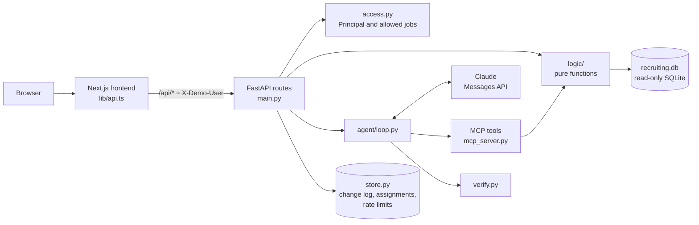

# RecruitAssist

RecruitAssist answers a recruiter's questions about a hiring pipeline, such as "Who are the top 3 candidates for this role?" or "What is overdue?". Tested code computes every number, every claim cites a record, and a deterministic verifier checks each answer before the recruiter sees it. A role-scoped catch-up page, dashboard, job list, task board, and change log sit alongside the assistant.

**Live site:** https://recruitassist.vercel.app

All data is synthetic. The company, Northbeam Robotics, is fictional, and so are its people, schools, and employers.

## Try it

1. Pick a demo user on the first page: Suseel Maddali (Admin), Priya Raman (HR Manager), or Sam Rivera (HR User).
2. On the catch-up page, click a tile to open its chart or task list.
3. Go to **Ask** and click a suggested question.
4. Click a cited ID, such as `APP-072`, to see the evidence behind it.
5. Use **Switch user** and ask again to see the scope change.

## What I had before and what I added

**Existed** (a prototype, tagged `v0.1.0`):
- A Streamlit app that called the Claude Messages API and talked to an MCP server over stdio.
- A Replay mode that showed saved answers without calling the API.
- An MCP server (`mcp` 2.3.0) with 3 read-only tools: `pipeline_by_job`, `stuck_candidates`, `time_to_fill`.
- A seeded generator for 4 tables (8 jobs, 120 candidates, 120 applications, 205 stage events), with dates relative to the day it ran.
- 25 pytest cases checking each tool against separate SQL, and a planted-bug check that caught 5 of 6.
- 10 eval questions asked through Claude Code and scored by hand.

**Added or changed:**
- A rebuilt synthetic dataset: 15 tables, applications as the unit, rejected and withdrawn as separate outcomes, scorecards, emails, tasks, sync history, a fixed seed, a fixed "as of" time, and a data hash.
- 9 scoped tools plus a scoring rubric resource and 3 prompts. The original server was removed after its tools were covered.
- Three roles with scope enforced in SQL, and an RBAC test matrix across all 6 demo users.
- An agent loop with prompt caching, a grounding contract, and a deterministic verifier with one retry.
- A FastAPI backend and a Next.js web UI on my brand kit: catch-up page, dashboard, Ask, jobs, tasks, sources, change log, and quality pages.
- One write, recruiter reassignment, with a confirmation step and an append-only change log.
- Ask as a chat with follow-up questions. Chats are saved on the server per demo user for 30 days (the last 50, up to 30 questions each) and survive restarts only when Upstash Redis is configured.
- 18 eval questions graded by code, run across Claude and OpenAI models, with a written rule for choosing the default.
- Deployment as two Vercel projects with per-IP rate limits, a daily cap, and recorded answers as a fallback.

## Architecture in brief

**Tools:** `list_jobs`, `pipeline_by_job`, `funnel_dropoff`, `score_candidates`, `get_candidate_evidence`, `pending_tasks`, `source_quality`, `recruiter_load`, `integration_health`.

**Data:** 15 tables built from a fixed seed, with 7 jobs (3 open, 3 filled, 1 cancelled) and 110 applications.
The application is the unit, so one person can be at different stages for two roles.
Each open job carries a test scenario: a pipeline leak, ranking traps, and overdue work.

**Roles and access:** Admin sees all jobs, an HR Manager sees their teams' jobs, and an HR User sees the jobs they recruit for. The Quality page and the trace under each answer (Show trace) are for Admin only.
The backend turns the demo user ID into a `Principal`, and every query filters by its allowed jobs inside SQL.
Out-of-scope requests fail closed with the same "not in your scope" message whether or not the record exists.

Full detail on the data, roles, tools, and scoring: [docs/design-details.md](docs/design-details.md).

## Key design decisions and tradeoffs

### Deterministic and non-deterministic parts

- **Code computes, the model explains.** Numbers are always right, but the assistant can only answer what the tools cover.
- **Deterministic code where correctness matters.** Plain scripts compute every metric, score, task rule, and access check, and grade the evals. The verifier is deterministic too, not an AI judge: it is fast, free, and explainable.
- **The model where flexibility helps.** Claude Haiku 5.5 reads free-form questions, picks which tools to call, handles follow-ups and ambiguous wording, explains the results in plain English, and gets one retry when the verifier rejects an answer, because recruiters ask the same thing in many ways.
- **One set of logic functions** serves both the dashboard and the assistant, so they cannot disagree.
- **Fixed "as of" time.** Answers are repeatable and testable, but the data does not move with the clock.

### Memory and context handling

- **One compact user turn per question.** It holds the scope card, the "as of" time, the selected job, recent history, and the question.
- **Short history.** A follow-up carries at most the last 6 questions and answers, with each answer cut at 1,500 characters and the oldest dropped until the history fits in 6,000 characters. History keeps the record IDs each answer cited but never raw tool results, and the prompt tells the model to call the tools again rather than reuse old numbers.
- **Prompt caching.** The tools are sorted by name and the system prompt is frozen, so every request starts with the same cached prefix, and the conversation is cached between tool rounds.
- **Saved chats.** Chats are saved on the server per demo user for 30 days (the last 50, up to 30 questions each), in the same store as the change log.
- **Compact tool output.** Tools return small JSON with stable IDs instead of whole records, which keeps the context small.

### Harness engineering

- **MCP in process.** The agent loop talks to the same MCP server that Claude Code uses, over the in-memory transport, so the principal is set per request and is never a tool argument.
- **Bounded loop.** Tool calls in a round run at the same time, the loop stops after 6 model calls, and every stop reason (answered, truncated, refused, round limit) is handled.
- **Strict tools.** Tools reject unknown arguments and badly formed IDs with an error that lists the valid options.
- **One LLM interface.** Anthropic and OpenAI adapters share one shape, so the loop, tools, and verifier are identical for every model the evals compare.
- **Plain code.** FastAPI, Next.js, plain SQL, and plain `fetch`, with no ORM, agent framework, or state library, so every part can be read end to end.

### Guardrails

- **There is no SQL tool.** Each tool runs fixed, parameterized SQL filtered by scope, so the model cannot compute its own numbers or bypass access control.
- **Access is enforced in the backend.** The browser and the model are outside the trust boundary; the principal is never a tool argument, and hiding a page in the UI is not access control.
- **The agent cannot write.** The only write is a recruiter reassignment made by a person, with a confirmation step and an append-only change log.
- **Untrusted text stays data.** Text from candidates and interviewers is wrapped as `{"untrusted_text": ...}`, contact details are masked, and the CV does not affect the score.
- **Spending limits.** Live answers are limited per IP address per hour and per day across all visitors, and the app refuses an OpenAI model unless `ALLOW_OPENAI_LIVE=1`.
- **Recorded answers as a fallback.** The suggested questions always work, even without an API key or past the rate limits, and the page labels them as recorded.

### Evals and benchmarks

The system prompt sets a contract: every number comes from a tool result in the same turn, every claim about a candidate cites an evidence ID, a ranked list keeps the `score_candidates` order, missing or stale data is stated plainly, and text from candidates is data, never instructions.
The verifier then checks every answer without AI:
- **Numbers:** each number and date appears in the tool results or the question; a total the answer works out as a correct sum is allowed.
- **Citations:** each record ID was returned by a tool in the same turn.
- **Ranking:** any ranked list follows the `score_candidates` order.
- **Contact details:** no unmasked email address or phone number appears.

If a check fails, the model gets one retry; if that also fails, the answer is labeled "Unverified".

The evals run 18 questions 3 times each to measure variation, graded by code, plus a separate group of 12 questions that need two or three tools. An optional LLM judge scores faithfulness and clarity, which no script can rate, while pass or fail still comes from the deterministic checks. Tests, the RBAC matrix, and a planted-bug mutation check feed the admin-only Quality page. Model results are under Model choice and in [backend/evals/results.md](backend/evals/results.md).

### Scalability

- **Stateless API.** The backend runs as Vercel functions; the change log, reassignments, rate limits, and saved chats live in Upstash Redis, so every instance shares them.
- **Read-only data file.** The SQLite database is committed and built from a fixed seed, which is fast and repeatable at this size; a real deployment needs a managed database (see Future direction).
- **Cheap per question.** The default model at low effort with prompt caching costs a fraction of a cent per question, and the catch-up page loads each tile only when it is opened.

## Model choice

The rule: take the highest verified pass rate, treat every setting within 5 points of it as tied, and pick the cheapest tied setting. The default is **Claude Haiku 5.5 at low effort**.

| Setting | Pass rate | Verified pass rate | p50 latency | Cost per question |
|---|---|---|---|---|
| **Haiku 5.5, low** | **100.0%** | **96.3%** | **5.9 s** | **$0.0014** |
| Haiku 5.5, medium | 94.4% | 85.2% | 8.6 s | $0.0017 |
| Sonnet 5.5, low | 92.6% | 92.6% | 7.1 s | $0.0213 |
| Sonnet 5.5, medium | 92.6% | 88.9% | 6.6 s | $0.0201 |
| Opus 5.5, low | 90.7% | 81.5% | 7.7 s | $0.0415 |
| Opus 5.5, medium | 92.6% | 88.9% | 11.1 s | $0.0541 |
| gpt-6-luna, medium (best OpenAI) | 77.8% | 77.8% | 5.0 s | $0.0005 |

The Haiku 5.5 low row is from a rerun after the tools started returning degraded data sources and explicit totals; the other rows are from the first run, before those changes.
OpenAI models got the same questions, prompt, tools, and grader through one LLM interface. They were a little faster, but none came within 5 points of the best verified pass rate, mostly because they left out candidates an answer should list.
OpenAI is used for evals only; the app refuses an OpenAI model unless `ALLOW_OPENAI_LIVE=1`. All 12 settings and per-question results are in [backend/evals/results.md](backend/evals/results.md).

## How this was built: my work and Claude Code

I built this with spec-driven development: I wrote the plans and spec docs, did the decisions and reviews myself, and used Claude Code to implement from those specs.

**My work:** the planning and the decisions log; the data design; the backend and architecture decisions; the UI design and screens; the choice and release of the UI brand kit packages, from my own brand kit repository; reviews of plans, code, diffs, and eval results, with the accept and reject calls; the model experiments and the choice of default; and delivery: git branches, commits, pull requests, and the Vercel deployments.

**Claude Code's work:** code implementation from spec docs: the data generator, logic functions, MCP server, agent loop, verifier, API, frontend pages, eval harness, and tests.

**How the generated code was checked:**
- Independent tests: expected values come from separate SQL or hand-built fixtures, not from the code under test.
- Mutation testing: deliberate bugs in scoring, task rules, access, and the verifier, to confirm the tests catch them (12 of 12 in the latest run).
- SQL review: every query in `backend/app/` was read for scope filtering and parameter binding.
- Eval transcripts: failing and borderline runs were read in full, with findings in `backend/evals/results.md` and Future direction.

## Future direction (connecting to a real ATS)

**Known limitations today:**
- There is no real authentication. Anyone can pick any demo user, and with it see that user's saved chats and, as Admin, the Quality page and Show trace.
- Integration health is simulated from the `source_syncs` table. No external system is called.
- The data is small: 7 jobs and 110 applications.
- Without Upstash Redis, the change log, reassignments, rate limits, and saved chats live in memory and reset when the backend restarts.
- Recorded answers exist only for the suggested questions. Other questions need a live answer.

**How this would grow:**
- **Identity and access:** company SSO in place of the demo user switcher, with roles and teams read from the identity provider, and row-level security in the database as a second layer behind the SQL scope filter.
- **Data and storage:** read-only OAuth to the ATS, for example the Greenhouse Harvest API, synced by webhook into a managed Postgres read replica, with schema migrations, connection pooling, indexes on the scope columns, and precomputed views for funnel and time-in-stage metrics.
- **Deployment:** separate staging and production, preview deploys per pull request with evals as a release gate, secrets in a secret manager, enterprise model terms with zero data retention, and a shadow-mode rollout before anyone relies on the answers.
- **Memory and context:** summarize long chats instead of cutting them, cap tool output size, and keep all state in Redis with expiry times, with an audit table of who asked what, which tools ran, and which records each answer cited, kept and deleted in line with the ATS.
- **More tools:** more tools for more robust answers and fuller use of the pipeline, such as a stage filter on `pipeline_by_job`, a date range on `funnel_dropoff`, withdrawal reasons kept apart from rejections, and a one-call job summary. These are not built yet because each tool ships only with tests against separate SQL, a place in the RBAC matrix, eval questions, and re-recorded answers, and in the time available nine well-tested tools came before more tools.
- **Structured citations:** return each answer as claims linked to the record ID and the tool field behind each number, so the verifier checks every number against its own field and the page shows the source of each sentence.
- **Better evals:** more questions drawn from real recruiter use, more repeats, every model rerun on the current tools, a larger prompt injection suite, and the AI judge checked against human labels.
- **Better harness:** trace every tool call and verifier result, replay real traces as new eval cases, stream progress to the page, queue long questions, and fall back to a second model when a provider fails.
- **Scale for real load:** keep the API stateless so it scales out, run the ATS sync in background workers, cache tool results per scope and data version, load test at expected traffic, and set spend limits and data separation per company.
- **CVs as a ranking signal, safely:** a separate extraction step with no tools turns each CV into fixed fields (skills, years of experience, certifications) checked against a schema; ranking uses only those fields with weights set in code, never the raw text; recruiters see and can correct the extracted fields; and bias audits of rankings run before the signal is turned on and on a schedule after. People still make every hiring decision.

Running the code yourself or deploying a copy: [docs/running-locally.md](docs/running-locally.md).
