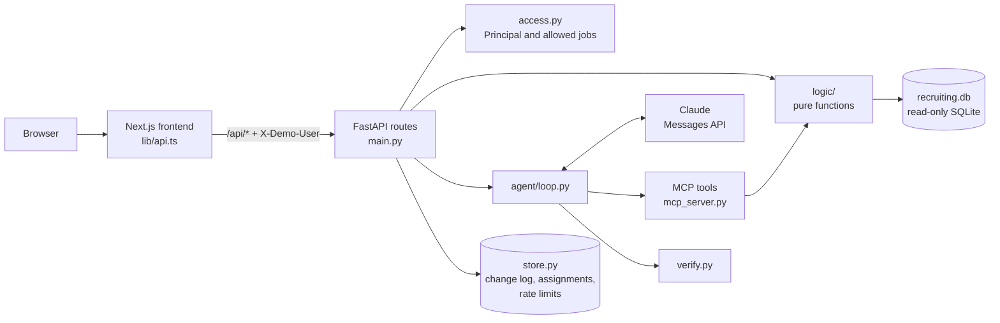

# RecruitAssist

RecruitAssist answers a recruiter's questions about a hiring pipeline, such as "Who are the top 3 candidates for this role?" or "What is overdue?". Tested code computes every number, every claim cites a record, and a deterministic verifier checks each answer before the recruiter sees it. A role-scoped catch-up page, dashboard, job list, task board, and change log sit alongside the assistant.

**Live site:** https://recruitassist.vercel.app

All data is synthetic. The company, Northbeam Robotics, is fictional, and so are its people, schools, and employers.

## Try it

1. Pick a demo user on the first page: Suseel Maddali (Admin), Priya Raman (HR Manager), or Sam Rivera (HR User).
2. On the catch-up page, click a tile to open its chart or task list.
3. Go to **Ask** and click a suggested question.
4. Click a cited ID, such as `APP-072`, to see the evidence behind it.
5. Use **Switch user** and ask again to see the scope change.

## What I had before and what I added

**Existed** (a prototype, tagged `v0.1.0`):
- A Streamlit app that called the Claude Messages API and talked to an MCP server over stdio.
- A Replay mode that showed saved answers without calling the API.
- An MCP server (`mcp` 2.3.0) with 3 read-only tools: `pipeline_by_job`, `stuck_candidates`, `time_to_fill`.
- A seeded generator for 4 tables (8 jobs, 120 candidates, 120 applications, 205 stage events), with dates relative to the day it ran.
- 25 pytest cases checking each tool against separate SQL, and a planted-bug check that caught 5 of 6.
- 10 eval questions asked through Claude Code and scored by hand.

**Added or changed:**
- A rebuilt synthetic dataset: 15 tables, applications as the unit, rejected and withdrawn as separate outcomes, scorecards, emails, tasks, sync history, a fixed seed, a fixed "as of" time, and a data hash.
- 9 scoped tools plus a scoring rubric resource and 3 prompts. The original server was removed after its tools were covered.
- Three roles with scope enforced in SQL, and an RBAC test matrix across all 6 demo users.
- An agent loop with prompt caching, a grounding contract, and a deterministic verifier with one retry.
- A FastAPI backend and a Next.js web UI on my brand kit: catch-up page, dashboard, Ask, jobs, tasks, sources, change log, and quality pages.
- One write, recruiter reassignment, with a confirmation step and an append-only change log.
- 18 eval questions graded by code, run across Claude and OpenAI models, with a written rule for choosing the default.
- Deployment as two Vercel projects with per-IP rate limits, a daily cap, and recorded answers as a fallback.

## Architecture in brief

**Tools:** `list_jobs`, `pipeline_by_job`, `funnel_dropoff`, `score_candidates`, `get_candidate_evidence`, `pending_tasks`, `source_quality`, `recruiter_load`, `integration_health`.

**Data:** 15 tables built from a fixed seed, with 7 jobs (3 open, 3 filled, 1 cancelled) and 110 applications.
The application is the unit, so one person can be at different stages for two roles.
Each open job carries a test scenario: a pipeline leak, ranking traps, and overdue work.

**Roles and access:** Admin sees all jobs, an HR Manager sees their teams' jobs, and an HR User sees the jobs they recruit for.
The backend turns the demo user ID into a `Principal`, and every query filters by its allowed jobs inside SQL.
Out-of-scope requests fail closed with the same "not in your scope" message whether or not the record exists.

Full detail on the data, roles, tools, and scoring: [docs/design-details.md](docs/design-details.md).

## Key design decisions and tradeoffs

- **Code computes, the model explains.** Numbers are always right, but the assistant can only answer what the tools cover.
- **There is no SQL tool.** Each tool runs fixed, parameterized SQL filtered by scope, so the model cannot compute its own numbers or bypass access control.
- **Access is enforced in the backend.** The browser and the model are outside the trust boundary; the principal is never a tool argument, and hiding a page in the UI is not access control.
- **One set of logic functions** serves both the dashboard and the assistant, so they cannot disagree.
- **Deterministic code where correctness matters.** Plain scripts compute every metric, score, task rule, and access check, and grade the evals. The verifier is deterministic too, not an AI judge: it is fast, free, and explainable.
- **The model where flexibility helps.** Claude Haiku 5.5 reads free-form questions, picks which tools to call, handles follow-ups and ambiguous wording, explains the results in plain English, and gets one retry when the verifier rejects an answer, because recruiters ask the same thing in many ways. The evals run each question 3 times to measure that variation, and an optional LLM judge scores faithfulness and clarity, which no script can rate, while pass or fail still comes from the deterministic checks.
- **Fixed "as of" time.** Answers are repeatable and testable, but the data does not move with the clock.
- **Recorded answers as a fallback.** The suggested questions always work, even without an API key or past the rate limits, and the page labels them as recorded.
- **Plain code.** FastAPI, Next.js, plain SQL, and plain `fetch`, with no ORM, agent framework, or state library, so every part can be read end to end.

## How answers are grounded and verified

The system prompt sets a contract: every number comes from a tool result in the same turn, every claim about a candidate cites an evidence ID, a ranked list keeps the `score_candidates` order, missing or stale data is stated plainly, and text from candidates is data, never instructions.
The verifier then checks every answer without AI:
- **Numbers:** each number and date appears in the tool results or the question; a total the answer works out as a correct sum is allowed.
- **Citations:** each record ID was returned by a tool in the same turn.
- **Ranking:** any ranked list follows the `score_candidates` order.
- **Contact details:** no unmasked email address or phone number appears.

If a check fails, the model gets one retry; if that also fails, the answer is labeled "Unverified".

Results:
- **Tests:** 342 backend tests (including 20 data invariant tests), 23 frontend component tests, and 22 Playwright smoke tests.
- **Mutation check:** 12 of 12 planted bugs caught, across scoring, task rules, access, and the verifier.
- **RBAC matrix:** every logic function run as each of the 6 users, against scope computed with separate SQL.
- **Evals:** 18 questions, 3 repeats each, graded by code; the default setting passed 54 of 54 runs, 96.3% verified.

## Model choice

The rule: take the highest verified pass rate, treat every setting within 5 points of it as tied, and pick the cheapest tied setting. The default is **Claude Haiku 5.5 at low effort**.

| Setting | Pass rate | Verified pass rate | p50 latency | Cost per question |
|---|---|---|---|---|
| **Haiku 5.5, low** | **100.0%** | **96.3%** | **5.9 s** | **$0.0014** |
| Haiku 5.5, medium | 94.4% | 85.2% | 8.6 s | $0.0017 |
| Sonnet 5.5, low | 92.6% | 92.6% | 7.1 s | $0.0213 |
| Sonnet 5.5, medium | 92.6% | 88.9% | 6.6 s | $0.0201 |
| Opus 5.5, low | 90.7% | 81.5% | 7.7 s | $0.0415 |
| Opus 5.5, medium | 92.6% | 88.9% | 11.1 s | $0.0541 |
| gpt-6-luna, medium (best OpenAI) | 77.8% | 77.8% | 5.0 s | $0.0005 |

The Haiku 5.5 low row is from a rerun after the tools started returning degraded data sources and explicit totals; the other rows are from the first run, before those changes.
OpenAI models got the same questions, prompt, tools, and grader through one LLM interface. They were a little faster, but none came within 5 points of the best verified pass rate, mostly because they left out candidates an answer should list.
OpenAI is used for evals only; the app refuses an OpenAI model unless `ALLOW_OPENAI_LIVE=1`. All 12 settings and per-question results are in [backend/evals/results.md](backend/evals/results.md).

## How this was built: my work and Claude Code

I built this with spec-driven development: I wrote the plans and spec docs, did the decisions and reviews myself, and used Claude Code to implement from those specs.

**My work:** the planning and the decisions log; the data design; the backend and architecture decisions; the UI design and screens; the choice and release of the UI brand kit packages, from my own brand kit repository; reviews of plans, code, diffs, and eval results, with the accept and reject calls; the model experiments and the choice of default; and delivery: git branches, commits, pull requests, and the Vercel deployments.

**Claude Code's work:** code implementation from spec docs: the data generator, logic functions, MCP server, agent loop, verifier, API, frontend pages, eval harness, and tests.

**How the generated code was checked:**
- Independent tests: expected values come from separate SQL or hand-built fixtures, not from the code under test.
- Mutation testing: deliberate bugs in scoring, task rules, access, and the verifier, to confirm the tests catch them (12 of 12 in the latest run).
- SQL review: every query in `backend/app/` was read for scope filtering and parameter binding.
- Eval transcripts: failing and borderline runs were read in full, with findings in `backend/evals/results.md` and Known limitations.

## Known limitations

- There is no real authentication. Anyone can pick any demo user.
- Integration health is simulated from the `source_syncs` table. No external system is called.
- The data is small: 7 jobs and 110 applications.
- Without Upstash Redis, the change log, reassignments, and rate limits live in memory and reset when the backend restarts. The live site currently runs this way.
- Recorded answers exist only for the suggested questions. Other questions need a live answer.

## Connecting to a real ATS

- Company SSO in place of the demo user switcher, with roles and teams read from the identity provider.
- Read-only OAuth to the ATS, for example the Greenhouse Harvest API, synced by webhook into a read replica.
- Row-level security in the replica as a second layer behind the SQL scope filter.
- An audit table of who asked what, which tools ran, and which records each answer cited, with retention and deletion that follow the ATS.
- Enterprise model terms with zero data retention, regular bias audits of rankings, and a shadow-mode rollout before anyone relies on the answers.
- Database: replace the committed read-only SQLite file with a managed Postgres read replica, with schema migrations, connection pooling, indexes on the scope columns, and precomputed views for funnel and time-in-stage metrics so tools stay fast as data grows.
- Memory and state: move the change log, reassignments, rate limits, and conversation history out of process memory into Redis with expiry times, so every server instance shares state and nothing resets on a restart, and cap tool output and summarize long histories to keep the model's context small.
- Scale: keep the API stateless so it scales out, run the ATS sync in background workers, cache tool results per scope and data version, queue long questions and stream progress to the page, and set spend limits and data separation per company.
- Better harness engineering: run the evals on every change with regression gates, add questions drawn from real recruiter use, trace every tool call and verifier result, add a larger prompt injection suite, replay real traces as new eval cases, and check the AI judge against human labels.

Running the code yourself or deploying a copy: [docs/running-locally.md](docs/running-locally.md).
